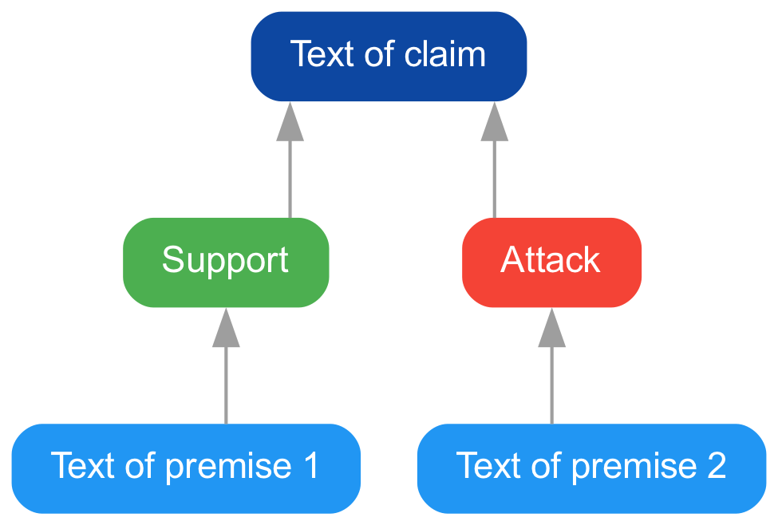

# Arguebuf Python

Arguebuf is a format for serializing argument graphs and specified using Protobuf.
The complete specification and documentation is available at the [Buf Schema Registry](https://buf.build/recap/arg-services/docs/main:arg_services.graph.v1).
While Protobuf automatically generates native code for all major programming languages (including Python), we created a custom implementation that provides some additional benefits, including:

- Import of existing formats like [AIF](http://www.argumentinterchange.org), [SADFace](https://github.com/Open-Argumentation/SADFace), and several others.
- Export of Arguebuf graphs to AIF, xAIF, [NetworkX](https://networkx.org), [Graphviz](https://graphviz.org), and [D2](https://d2lang.com).
- Various helper methods to programmatically manipulate and create argument graphs.
- More pythonic interfaces than the regular code generated by `protoc`.

A TypeScript implementation with the same features is available as [arguebuf-typescript](https://github.com/recap-utr/arguebuf-typescript).

## Installation

You can install the library from [PyPI](https://pypi.org/project/arguebuf/).

```shell
pip install arguebuf
```

The documentation is hosted on [ReadTheDocs](https://arguebuf.readthedocs.io/en/latest/).

## Theoretical Foundations

An argument graph is a way to represent _structured_ argumentation.
What sets it apart from _unstructured_ argumentation (e.g., in newspaper articles) is that only the essential and argumentative parts of a text are part of this representation.
These _units_ of argumentation are also called ADUs (argumentative discourse units).
The length of ADUs can differ dramatically (depending on various factors like the context), meaning they might contain only a few words, a sentence, or even a whole paragraph.
The structure of an argument is then represented through _relations_ between these units.
For this purpose, they can be further subdivided into _claims_ and _premises_.
A claim is a statement that is supported or attacked by one or multiple premises.
At the same time, a claim may also function as a premise for another claim, making it possible to construct even complex _argument graphs_.
One of the claims is called _major claim_ and represents the overall claim of the whole argument.
In many cases (but not all), this major claim is located right at the top of the graph.
Here is a rather simple example.



Claims, premises and the major claim are represented as _atom nodes_ while relations between them are represented by _scheme nodes_.
The set of nodes $V = A \cup S$ is composed of the set of atom nodes $A$ and the set of scheme nodes $S$.
The supporting or attacking relations are encoded in a set of edges $E \subseteq V \times V \setminus A \times A$.
Edges can be drawn between any type of nodes except for two atom nodes.
For instance, it is possible to connect two scheme nodes to support or attack the _inference_ between two ADUs.
Based on this, we define an argument graph $G$ as the triple $G = ( V , E , M )$.

## Usage

When importing this library, we recommend using an abbreviation such as `ag` (for _argument graph_).

```python
import arguebuf as ag
```

In the following, we will introduce the most important features of `arguebuf`.
For more details including examples, check out our API documentation.

### Creating a Graph

Graphs are immutable, so they can be shared freely, e.g. in an undo history.
They are built and changed via a `GraphDraft`, whose `freeze` returns the graph.
The following example creates a graph with two premises that are connected to a major claim.

```python
draft = ag.GraphDraft()

premise1 = ag.AtomNode("Text of premise 1")
premise2 = ag.AtomNode("Text of premise 2")
claim = ag.AtomNode("Text of claim")

scheme1 = ag.SchemeNode(ag.Support.DEFAULT)
scheme2 = ag.SchemeNode(ag.Attack.DEFAULT)

for node in (premise1, premise2, claim, scheme1, scheme2):
    draft.add_node(node)

draft.add_edge(ag.Edge(premise1.id, scheme1.id))
draft.add_edge(ag.Edge(scheme1.id, claim.id))
# shorthand for the edges from the premises to the scheme and from the scheme to the claim
draft.connect([premise2], scheme2, claim)

draft.major_claim = claim
graph = draft.freeze()
```

Rendering it with Graphviz (see below) results in the following image.


### Loading a Graph

The loaders in `ag.load` support the following formats:

- Arguebuf as Protobuf message (`ag.load.protobuf`) or its JSON representation.
- [AIF](http://www.argumentinterchange.org) and its extension xAIF (`ag.load.aif`, `ag.load.xaif`).
- [OVA](http://ova.uni-trier.de) (`ag.load.ova`).
- [SADFace](https://github.com/Open-Argumentation/SADFace) (`ag.load.sadface`).
- The JSON export of [Argdown](https://argdown.org) (`ag.load.argdown`).
- [Kialo](https://www.kialo.com) discussion exports (`ag.load.kialo`).
- [BRAT](https://brat.nlplab.org) standoff annotations (`ag.load.brat`).
- The XML formats of the [Microtexts](https://github.com/peldszus/arg-microtexts) corpus (`ag.load.microtexts`) and [Araucaria](https://arg-tech.org) (`ag.load.aml`).

JSON objects are passed to `ag.load.dict`, which detects their format by checking the following keys in order.

1. An `AIF` key denotes xAIF.
2. An `analysis` key denotes OVA.
3. A `metadata` object with a `core` key denotes SADFace.
4. The keys `statements`, `arguments`, and `relations` denote the Argdown JSON export.
5. A `nodes` list denotes AIF.
6. Everything else is parsed as Arguebuf JSON.

Every loader accepts an optional `name` for the graph, which is `None` by default.
Kialo exports set the name to their discussion title.
Numeric ids of JSON formats must be integers between `-(2**53 - 1)` and `2**53 - 1` and are converted to strings.
Use strings for larger ids.
Reference offsets count Unicode code points like Python string indices and all serialized formats.
The TypeScript implementation uses UTF-16 indices in memory, as JavaScript strings do, and converts them when loading and dumping.
AIF and xAIF loaders skip dialog nodes (L, TA, YA), pass `reconstruct_dialog=True` to connect the atoms they link via rephrase nodes instead.
The loaders `dict`, `json`, `io`, `file`, `folder`, and `casebase` forward this option to them.

### Strict Model and Lenient Loaders

The model is strict.
Adding an element to a draft raises a `GraphError` (a `ValueError`) if its id is already taken or if it references an element (e.g., the nodes of an edge or the participant of an atom node) that has not been added to the graph before.
Edges must not be self-loops, connect two atoms, or duplicate an existing connection.
Elements reference each other by id, e.g. `edge.source`, `node.participant`, and `node.reference.resource` are ids, while the methods of graphs and drafts accept elements or ids.
Removing an element also removes or unsets all references to it, e.g., removing a node also removes its edges.
Removing a node also removes the scheme nodes that are left without a premise or a conclusion, recursively, so that the graph stays consistent.
`draft.remove_elements(ids)` removes elements of any kind at once, skipping those already removed by a cascade of the same call.
Like `remove_node` and `remove_branch`, it returns the ids of all removed elements, including those of the cascades, and so do the other `remove_*` and `clean_*` methods.
`ag.Graph` and `ag.GraphDraft` also accept `nodes`, `edges`, `resources`, `participants`, `analysts`, and `major_claim` to create a graph with its elements at once, which are validated like the `add_*` methods.
Functions that only read a graph (`ag.check`, `ag.outline`, and the dumpers) accept an `ag.GraphView`, so both graphs and drafts can be passed.
`draft.link(source, target, scheme=...)` connects two nodes, two atoms through a new scheme node (untyped by default) that it returns.
`graph.check_link(source, target)` returns the issue that prevents such a link without raising, e.g. to validate a connection while it is drawn.
`graph.annotations(resource)` lists the atoms whose references are anchored in a resource with their spans, sorted by position.

All elements are frozen and changed via the typed methods `update_atom`, `update_scheme`, `update_edge`, `update_resource`, `update_participant`, and `update_analyst` of a draft, which validate the new values like their `add_*` counterparts.
They set the modification time of the element's metadata to now unless `metadata` is given.
Changing the text of a resource re-anchors the references to it and returns the resulting warnings (see `draft.relocate_references`).
`graph.draft()` and `draft.freeze()` take constant time: graphs and drafts share all elements, userdata, and containers, and a draft clones a container only when it changes it first.
A draft stays usable after `freeze`, and the graphs it returned never change.
Userdata is shared as is, so replace it via `update_*` instead of changing it in place.

```python
changed = graph.edit(lambda draft: draft.update_atom(claim, text="New text of claim"))


def promote(draft: ag.GraphDraft) -> None:
    draft.update_atom(claim, text="New text of claim")
    draft.major_claim = claim


promoted = graph.edit(promote)
```

`graph.edit(recipe)` works like `produce` of immer: it runs the recipe on a draft and returns the frozen result, so the draft never escapes, and a recipe that raises changes nothing.
`graph.draft()` and `draft.freeze()` are the building blocks for edits that span several steps, e.g. a loader that builds a graph piece by piece.

Views without scheme nodes are projections that leave the graph unchanged.
`graph.atom_relations()` lists the pairs of atoms connected via a scheme node, and the Graphviz, D2, and NetworkX dumpers accept `scheme_nodes=False` to connect atoms directly by edges colored like their schemes.

Loaders are lenient.
They repair what they can and skip the rest: an edge between two atoms gets an untyped scheme in between, while self-loops, duplicate connections, duplicate nodes, and elements referencing unknown ones are skipped.
References whose text is not found at their offset are moved to the most similar span of their resource (see `draft.relocate_references`).
Each repair is reported as a warning to the `on_issue` callback, which defaults to logging it, and `strict=True` raises a `GraphError` instead.
Malformed values such as unparsable dates always raise an error.
Loaders do not copy the objects they read, so the userdata of a graph may share objects with the input.

### Issues

Errors and warnings are `ag.Issue` objects, `issue.to_dict()` converts them to JSON.
Their `code` is identical in all implementations of arguebuf, their `message` names the affected elements, and their `hint` suggests a remedy.
A `GraphError` carries the issue that caused it.

The model cannot prevent everything, e.g. a scheme node without premise is valid while the graph is being built.
`ag.check` reports these remaining problems of a graph, from untyped schemes and references that do not match their resource to atoms that are not connected to the major claim.

```python
for issue in ag.check(graph, ignore=["no-major-claim"]):
    print(issue.severity, issue.message, issue.hint)
```

### References

`ag.locate` finds the span of a text that matches a quote best, its offset counts code points.
Verbatim matches are preferred, otherwise both texts are reduced to their lowercase words (letters and digits) and minor differences are tolerated up to a `threshold` of similarity.

```python
ag.locate("Cats are the best pets. They are independent.", "they are independant")
# Match(offset=24, text='They are independent', similarity=0.95)
```

### Patches for Agents

`ag.apply_patch` applies a patch to a graph, which references all elements by id and is meant to be written by agents.
An item creates an element if its id is new and otherwise updates the given fields, `remove` deletes elements.
Texts of atoms are linked to the most similar spans of the resources.
A scheme is named by its type and optionally its label (e.g. "Expert Opinion"), unknown labels fall back to the default scheme with an `unknown-scheme` warning.
The patch is applied all or nothing to a draft of the graph, so the result contains the unchanged input graph if there is an error.
Otherwise, the result lists the ids of the `created`, `updated`, and `removed` elements, removals include the schemes removed together with a node.
Every issue points to the item that caused it via its `path`, so that an agent can correct it.
`ag.parse_patch` validates untrusted input against `ag.PATCH_SCHEMA` and reports every problem as an `invalid-patch` error with its path.
The schema forbids unknown keys, an application may pass an extension of it to validate additional fields of its own.

```python
result = ag.apply_patch(
    graph,
    {
        "atoms": [
            {"id": "claim", "text": "Cats are the best pets"},
            {"id": "premise", "text": "They are independent"},
        ],
        "schemes": [
            {"id": "support", "type": "support", "premises": ["premise"], "conclusion": "claim"}
        ],
        "majorClaim": "claim",
    },
)
```

`ag.outline` returns a graph in the shape of a patch, and `ag.PATCH_SCHEMA` describes patches as JSON Schema for the tools of agents.
A scheme can be the conclusion of another scheme, e.g. to undercut it.

### Exporting a Graph

The dumpers in `ag.dump` support the following formats:

```python
# Arguebuf as Protobuf message
message = ag.dump.protobuf(graph)

# Arguebuf, AIF, or xAIF as JSON object
obj = ag.dump.dict(graph, format="aif")

# Directed NetworkX graph
nx_graph = ag.dump.networkx(graph)

# Graphviz graph (pygraphviz.AGraph)
gv_graph = ag.dump.graphviz(graph)

# D2 diagram
d2_graph = ag.dump.d2(graph)
```

AIF and xAIF exports are lossy, they do not contain locutions, participants of atom nodes, or userdata.

### Userdata

Every graph, node, edge, resource, participant, and analyst has `userdata`, a JSON object (`ag.JsonObject`) by default.
The type parameters of `Graph` customize it per kind in the order atom, scheme, edge, resource, participant, analyst, graph, omitted kinds keep `JsonObject`.
Each element class is generic in its own userdata type, e.g. `ag.AtomNode[AtomData]`.
In memory, userdata may hold anything, for example numpy arrays or class instances.

A codec converts between the in-memory userdata and its persisted JSON object.
Loaders call `validate_python` for every element they create, with its userdata from the input, JSON built by the loader (e.g. the Argdown metadata), or `{}`.
The Protobuf and Arguebuf JSON dumpers call `dump_python(value, mode="json")`, so data that should not be persisted is left out there.
Both take `codecs=ag.Codecs(...)`, which is required exactly for the customized kinds, while AIF, xAIF, Graphviz, and D2 exports need none.
Loaders infer the type of the graph from the codecs.

```python
from dataclasses import dataclass
from typing import Literal

import numpy as np


@dataclass
class AtomData:
    label: str
    embedding: np.ndarray | None = None


class AtomCodec:
    def validate_python(self, obj: ag.JsonObject, /) -> AtomData:
        if not isinstance(label := obj.get("label"), str):
            raise TypeError("The label must be a string.")

        return AtomData(label)

    # the embedding is not persisted
    def dump_python(
        self, instance: AtomData, /, *, mode: Literal["json"]
    ) -> ag.JsonObject:
        return {"label": instance.label}


codecs = ag.Codecs(atom=AtomCodec())
# ag.Graph[AtomData]
graph = ag.load.file("graph.json", codecs=codecs)
atom = graph.atom_nodes[id]
graph = graph.edit(
    lambda draft: draft.update_atom(
        atom, userdata=AtomData(atom.userdata.label, embed(atom.text))
    )
)
ag.dump.file(graph, "graph.json", codecs=codecs)
```

The method names match `pydantic.TypeAdapter`, which can be passed directly.

```python
from pydantic import BaseModel, Field, TypeAdapter


class AtomData(BaseModel):
    label: str
    embedding: list[float] = Field(default_factory=list, exclude=True)


codecs = ag.Codecs(atom=TypeAdapter(AtomData))
```

Name a combination of userdata types once, e.g. `type MyGraph = ag.Graph[AtomData]`, and annotate drafts you create yourself (`draft: ag.GraphDraft[AtomData] = ag.GraphDraft()`).
Constructors make `userdata` optional (defaulting to `{}`) only for JSON object userdata.
Likewise, `connect` requires a userdata factory for the edges it creates if the edge userdata is customized, and `ag.apply_patch` requires the codecs to create userdata.
Nodes reference participants, resources, and their edge endpoints by id, look them up in the graph to get them with their userdata type (e.g. `graph.participants[node.participant]`).
`copy.deepcopy(graph)` copies userdata without its codec, so in-memory data is kept.

For throwaway data like caches, a side table keyed by element ids avoids custom types altogether:

```python
embeddings: dict[str, np.ndarray] = {}
embeddings[node.id] = embed(node.text)
```

### Dates

All timestamps are timezone-aware `datetime` objects in UTC.
Timestamps without timezone are interpreted as UTC.
Each format uses one strict pattern:

- AIF: `%Y-%m-%d %H:%M:%S`.
- OVA: `%d/%m/%Y - %H:%M:%S` for nodes and edges and `%d/%m/%Y` for the document date.
- SADFace: ISO 8601.

Missing creation and modification timestamps default to the current time, malformed timestamps raise an error.

## Python Specifics

### Files and Folders

A file is loaded with `ag.load.file`, its suffix determines the format: `.json`, `.ann` (BRAT), `.txt` (Kialo or plain text), `.xml` (Microtexts), and `.aml` (Araucaria).
The name of the graph is the file name without suffix.
One can either pass a string pointing to the file or a `pathlib.Path` object.

```python
graph = ag.load.file("graph.json")
```

It is also possible to load multiple graphs within a folder.
Here, you need to pass the folder along with a [glob pattern](https://docs.python.org/3/library/fnmatch.html#module-fnmatch) for selecting the argument graphs.
This also allows to recursively load all argument graphs from a common parent directory.

```python
graphs = ag.load.folder("./data", "**/*.json")
```

Graphs are saved as JSON files with `ag.dump.file`.
If the path is an existing folder, the graph is saved as `<name>.json` inside it, which requires a name that is a valid file name.

```python
# Save the graph as Arguebuf
ag.dump.file(graph, "./graph.json")

# Save the graph as AIF
ag.dump.file(graph, "./graph.json", format="aif")
```

### Rendering

Graphs exported to Graphviz or D2 can be rendered as images.
Both dumpers return `None` for graphs with more than `max_nodes` nodes.
The output format is derived from the suffix of the path.
Rendering D2 diagrams requires the `d2` executable.

```python
if gv_graph := ag.dump.graphviz(graph):
    ag.render.graphviz(gv_graph, "./graph.pdf")

if d2_graph := ag.dump.d2(graph):
    ag.render.d2(d2_graph, "./graph.svg")
```

### Command Line Interface (CLI)

We also offer some tools to simplify dealing with structured argument graphs.
Among others, it is possible to convert graphs between different formats, translate them, and render images using Graphviz.
To use it, install the `cli` extras when installing the package.
When using `pip`, this can be accomplished with the following command.

```shell
pip install arguebuf[cli]
```

Afterwards, you can execute it by calling `arguebuf`, for example:

```shell
arguebuf --help
```

`arguebuf graph check` reports the repairs applied while loading graphs and the problems found by `ag.check`, its exit code is non-zero if an issue reaches the severity given by `--fail-on`.
`arguebuf graph render --remove-scheme-nodes` connects atoms directly in the rendered images.

Alternatively, you can use the Docker image available at `ghcr.io/recap-utr/arguebuf-python`.
To use it, mount a folder to the container and pass the options as the command.

```shell
docker run --rm -it -v $(pwd)/data:/data ghcr.io/recap-utr/arguebuf-python:latest --help
```

If you use the `nix` package manager, you can run it as follows:

```shell
nix run github:recap-utr/arguebuf-python -- --help
```

## Development

To pull the testing data, make sure to install [DVC](https://dvc.org/doc/install) and run `dvc pull` in the root directory of the repository.
